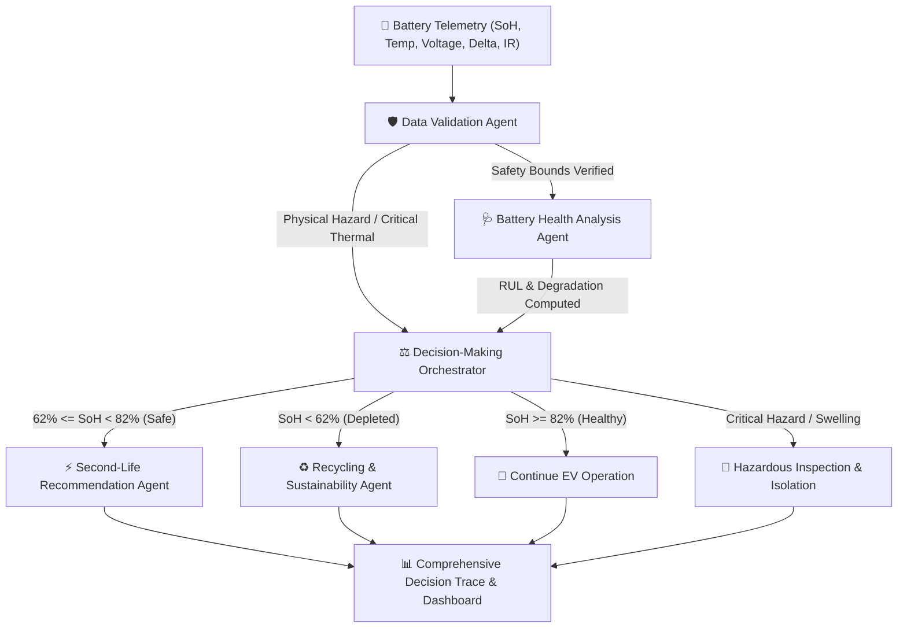

# 🌱 EcoLoop AI — Autonomous EV Battery Waste Prevention System

[](LICENSE)
[](backend/)
[](frontend/)
[](index.html)

**EcoLoop AI** is an Agentic AI-powered autonomous EV battery waste prevention platform. It coordinates specialized cooperating AI agents that ingest electrochemical telemetry from retired electric vehicle (EV) battery packs, diagnose remaining state of health, arbitrate lifecycle pathways, and match batteries to optimal second-life applications (such as stationary solar microgrids and backup power) before routing depleted or hazardous units to authorized circular recycling.

---

## 📑 Table of Contents

- [The Problem We Solve](#-the-problem-we-solve)
- [Multi-Agent Architecture](#-multi-agent-architecture)
- [The Cooperating AI Agents](#-the-cooperating-ai-agents)
- [Key Features](#-key-features)
- [Project Directory Structure](#-project-directory-structure)
- [How to Run EcoLoop AI](#-how-to-run-ecoloop-ai)
  - [Method 1: Instant Browser Mode (Zero Installation)](#method-1-instant-browser-mode-zero-installation)
  - [Method 2: Full-Stack Mode (Python FastAPI + Frontend)](#method-2-full-stack-mode-python-fastapi--frontend)
- [Beginner's Guide: Uploading to GitHub](#-beginners-guide-uploading-to-github)
- [Publishing to GitHub Pages (Live Website)](#-publishing-to-github-pages-live-website)
- [Safety & Advisory Standards](#-safety--advisory-standards)

---

## ⚡ The Problem We Solve

Electric vehicles typically retire battery packs when their **State of Health (SoH)** declines to **70%–80%** because automotive demands (high instantaneous acceleration and weight-sensitive range) are stringent. 

However, a battery at 75% SoH still retains substantial energy capacity! Discarding or prematurely smelting these packs leads to:
- Severe resource waste of critical battery minerals (Lithium, Nickel, Cobalt).
- Massive greenhouse gas emissions from virgin mining.
- High cost barriers for renewable energy storage.

**EcoLoop AI** solves this by autonomously analyzing used battery packs and safely orchestrating their transition into **second-life stationary energy storage** before recycling.

---

## 🧠 Multi-Agent Architecture

The autonomous decision pipeline flows deterministically through 4 primary cooperative agents plus input validation:



---

## 🤖 The Cooperating AI Agents

### 1. 🛡️ Data Validation Agent
- **Role:** Telemetry sanity check, boundary validation, and immediate physical hazard screening.
- **Rules Enforced:**
  - Detects physical casing flaws (`Swelling`, `Puncture`, `Corrosion`, `Seal Breach`).
  - Flags extreme temperature excursions ($T > 50^\circ\text{C}$ or $T < -20^\circ\text{C}$).
  - Catches dangerous cell voltage imbalance ($\Delta V \ge 0.12\text{V}$).
  - Triggers safety overrides if physical integrity is compromised.

### 2. 🩺 Battery Health Analysis Agent
- **Role:** Electrochemical degradation analysis and useful life projection.
- **Model:** Clearly labeled *Deterministic Electro-Chemical Degradation Heuristic (Demo Model v1.2)*.
- **Outputs:**
  - State of Health (SoH %) verification.
  - Estimated Remaining Useful Life (RUL) in cycles and calendar years.
  - Cell balance status and internal resistance impedance health ($m\Omega$).
  - Professional laboratory inspection triggers.

### 3. ⚡ Second-Life Recommendation Agent
- **Role:** Multi-criteria secondary application matching.
- **Evaluated Applications:**
  - **Stationary Solar Microgrid Storage:** High suitability for buffering residential and community solar.
  - **Residential Backup Power & Telecom UPS:** Ideal for standby emergency power without daily cycling stress.
  - **Off-Grid Agricultural Irrigation Storage:** Ruggedized decentralized farm microgrid support.
- **Outputs:** Suitability percentage scores (0–100%), tier classifications, technical limitations, and installation safety requirements.

### 4. ♻️ Recycling & Sustainability Agent
- **Role:** Closed-loop circular economy yield calculation.
- **Estimated Material Recovery:**
  - Recoverable Lithium ($\text{Li}_2\text{CO}_3$ equivalent), Battery-Grade Nickel, Cobalt Sulfate, Refined Copper, Aluminum, and Synthetic Graphite.
- **Environmental Benefits:**
  - $\text{CO}_2$ emissions avoided vs. virgin open-pit mineral mining.
  - Landfill mass diverted (94% recovery rate benchmark).
  - Fresh water conserved.
  - Authorized hydrometallurgical recycling facility routing.

### 5. ⚖️ Decision-Making Orchestrator Agent
- **Role:** Master coordination, policy enforcement, and final consensus arbitration.
- **Decisions:**
  - `CONTINUE_EV`: High health; keep in vehicle or Certified Pre-Owned fleet.
  - `EVALUATE_SECOND_LIFE`: Safe degradation sweet spot; deploy to stationary grid.
  - `INSPECT_OR_REPAIR`: Physical anomaly or thermal hazard; route to certified laboratory.
  - `RECYCLE_NOW`: Depleted capacity; extract critical minerals via hydrometallurgical refining.
- **Explainability:** Generates a step-by-step audit trace with exact rule citations.

---

## ✨ Key Features

- 🟢 **Instant Feedback Loop:** Adjusting any slider or input immediately triggers real-time multi-agent re-evaluation.
- ⚡ **Curated Demo Presets:** 5 one-click scenarios covering healthy packs, prime second-life solar packs, emergency thermal swelling hazards, and depleted end-of-life batteries.
- 🔍 **Transparent Reasoning Trace:** Clear step-by-step logs showing which rules were evaluated and why decisions were made.
- 🛡️ **Safety-First Design:** Never certifies damaged or swollen batteries for reuse.
- 🌐 **Zero-Config GitHub Pages Ready:** Runs directly in any web browser without needing terminal commands or package installation.
- 🔌 **Optional Full-Stack Integration:** Includes a complete Python FastAPI backend for developers wanting dedicated REST API microservices.

---

## 📁 Project Directory Structure

```text
ecoloop-ai/
│
├── index.html                    # Complete Interactive App (Zero-Config GitHub Pages Entry)
├── .gitignore                    # Git ignore file for Python, Node, and IDEs
├── README.md                     # Documentation and Setup Guide
│
├── .github/
│   └── workflows/
│       └── deploy.yml            # GitHub Actions 1-Click Pages Deployment Workflow
│
├── backend/                      # Python FastAPI Multi-Agent Backend
│   ├── main.py                   # FastAPI REST API endpoints
│   ├── requirements.txt          # Python dependencies
│   ├── agents/                   # Modular Agent Classes
│   │   ├── __init__.py
│   │   ├── base.py               # Abstract Base Agent
│   │   ├── validation_agent.py   # Data Validation Agent
│   │   ├── health_agent.py       # Battery Health Agent
│   │   ├── second_life_agent.py  # Second-Life Agent
│   │   ├── recycling_agent.py    # Recycling Agent
│   │   └── orchestrator.py       # Master Orchestrator Agent
│   ├── models/                   # Pydantic Schemas
│   │   ├── __init__.py
│   │   └── battery.py
│   ├── data/
│   │   └── sample_batteries.json # Sample datasets
│   └── tests/
│       └── test_agents.py        # Automated Pytest Suite
│
└── frontend/                     # Modular React + Tailwind Source Code
    ├── package.json              # Node packages
    ├── vite.config.js            # Vite configuration
    ├── tailwind.config.js        # Tailwind styling theme
    ├── src/
    │   ├── App.jsx               # Main React Application
    │   ├── main.jsx              # React DOM mounting
    │   ├── index.css             # Tailwind base stylesheets
    │   └── services/
    │       └── agentEngine.js    # Client-side agent simulation engine
    └── index.html                # Vite HTML template
```

---

## 🚀 How to Run EcoLoop AI

### Method 1: Instant Browser Mode (Zero Installation)

1. Navigate to the project folder on your computer.
2. Double-click **`index.html`** or right-click and select **Open with Google Chrome / Microsoft Edge**.
3. That is it! The multi-agent simulation engine runs entirely inside your browser with full interactivity.

---

### Method 2: Full-Stack Mode (Python FastAPI + Frontend)

If you would like to run the Python FastAPI backend locally:

#### 1. Start the Python FastAPI Backend:
Open PowerShell or your terminal:
```bash
# Navigate to the backend folder
cd backend

# Create a Python virtual environment (optional but recommended)
python -m venv venv

# Activate the virtual environment
# On Windows:
venv\Scripts\activate
# On Mac/Linux:
source venv/bin/activate

# Install required dependencies
pip install -r requirements.txt

# Run the FastAPI server
uvicorn main:app --reload --port 8000
```
*The API will start at `http://localhost:8000`. You can test the interactive API docs at `http://localhost:8000/docs`.*

#### 2. Open the Website:
Simply open `index.html` in your browser and click **Connect FastAPI** at the top right to link the website with your live Python backend!

---

## 🐙 Beginner's Guide: Uploading to GitHub

If you have never used Git or GitHub before, follow these simple steps:

### Step 1: Install Git (if not already installed)
1. Download Git from [https://git-scm.com/downloads](https://git-scm.com/downloads).
2. Run the installer and click **Next** through the setup (default settings are fine).
3. Open a new PowerShell terminal to verify Git is installed:
   ```bash
   git --version
   ```

### Step 2: Configure Git with Your Name and Email
Run these two commands in PowerShell (replace with your details):
```bash
git config --global user.name "Your Name"
git config --global user.email "your.email@example.com"
```

### Step 3: Create a New Repository on GitHub
1. Open your browser and go to [https://github.com](https://github.com).
2. Sign in (or create a free account).
3. Click the **+** (plus icon) in the top-right corner and choose **New repository**.
4. Set **Repository name** to: `ecoloop-ai`.
5. Keep it **Public**.
6. **Important:** Leave "Add a README file", ".gitignore", and "License" **UNCHECKED** (we already created them in your project).
7. Click **Create repository**.
8. Copy the repository URL (e.g., `https://github.com/your-username/ecoloop-ai.git`).

### Step 4: Initialize Git and Push Your Project
Open PowerShell, navigate to your project directory, and run:

```bash
# 1. Navigate to your project folder
cd "C:\Users\RAHAVAN\.gemini\antigravity\scratch\ecoloop-ai"

# 2. Initialize a new Git repository
git init

# 3. Add all project files
git add .

# 4. Create your first commit
git commit -m "Initial commit: EcoLoop AI Agentic EV Battery Waste Prevention System"

# 5. Rename branch to main
git branch -M main

# 6. Link to your GitHub repository (paste your GitHub URL from Step 3)
git remote add origin https://github.com/your-username/ecoloop-ai.git

# 7. Push your code to GitHub
git push -u origin main
```
*When prompted, sign in with your GitHub account credentials or browser token.*

---


## 🛡️ Safety & Advisory Standards

> [!IMPORTANT]
> **Advisory Guidance Notice:** Recommendations produced by EcoLoop AI agents are purely advisory simulations based on electrochemical heuristics. They do **not** replace physical laboratory safety certification (such as **UL 1974** standard for EV battery repurposing or **IEC 62619** for industrial secondary storage). Batteries exhibiting swelling, thermal anomalies, or casing damage must **never** be certified for second-life use without professional physical diagnostics.

---

## 📜 License

This project is licensed under the MIT License — see the [LICENSE](LICENSE) file for details.
